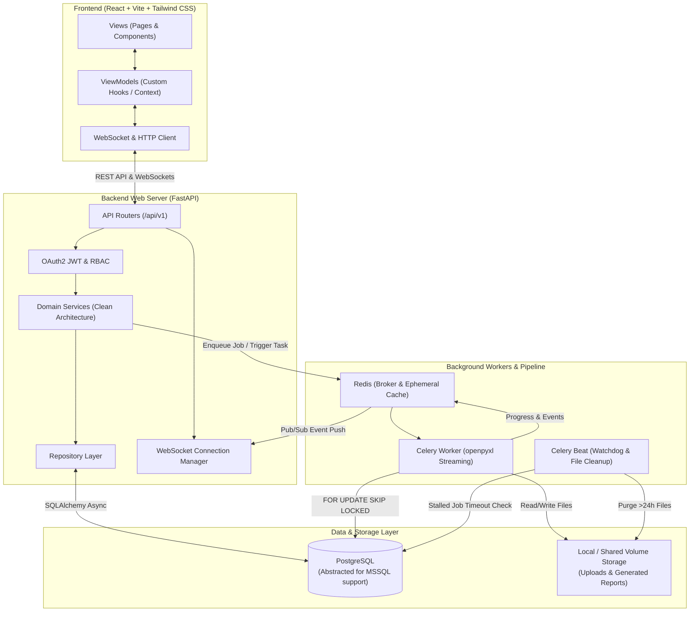

############################################################ REQUEST
---

# Refactoring Request: to Modern Web Application

Please refactor into a high-performance, production-ready web application adhering to the specifications below.

---

## 1. App Architecture & Tech Stack

### Architecture Guidelines

* **Strict Separation of Concerns:** Decoupled frontend and backend communicating via REST API and WebSockets.
* **Frontend:** MVVM (Model-View-ViewModel) architectural pattern.
* **Backend:** Clean Architecture utilizing the **Service-Repository pattern**.

### Technology Stack

* **Frontend:** React.js, Vite, Tailwind CSS
* **Backend:** Python 3.13+, FastAPI, SQLAlchemy (Async), OAuth2 with JSON Web Tokens (JWT), Role-Based Access Control (RBAC)
* **Database:** PostgreSQL (with database abstraction layer to maintain compatibility with Microsoft SQL Server for future switching if needed)
* **Real-Time Communication:** WebSockets
* **Deployment Package:** Docker & Docker Compose

---

## 2. Performance & User Experience

* Implement asynchronous request handling and non-blocking background workers for heavy operations.
* Provide interactive loading indicators and real-time progress updates for long-running tasks:
* Server connection verification
* Large Excel import/export processing
* Heavy database batch updates


---

## 3. Asynchronous Long-Running Task Architecture (Import/Export Pipeline)

To prevent server bottlenecks and request timeouts when multiple concurrent users handle large datasets, all heavy import and export operations must follow an **Async Job + Polling/WebSocket** workflow.

### A. Database Schema (PostgreSQL)

Create a `jobs` table to track the state, progress, and metadata of all asynchronous operations:

```sql
CREATE TYPE job_type AS ENUM ('import', 'export');
CREATE TYPE job_status AS ENUM ('pending', 'processing', 'completed', 'failed');

CREATE TABLE jobs (
    id UUID PRIMARY KEY DEFAULT gen_random_uuid(),
    user_id BIGINT NOT NULL,
    type job_type NOT NULL,
    status job_status DEFAULT 'pending',
    progress INT DEFAULT 0, -- Completion percentage (0 - 100)
    input_file_path TEXT, -- Original file path (for imports)
    output_file_path TEXT, -- Resulting file path (for exports)
    result_meta JSONB, -- Detailed execution metadata (successful rows, error counts, etc.)
    error_message TEXT, -- Error log if the task fails
    timeout_at TIMESTAMP WITH TIME ZONE, -- Task expiration timeout timestamp
    created_at TIMESTAMP WITH TIME ZONE DEFAULT NOW(),
    updated_at TIMESTAMP WITH TIME ZONE DEFAULT NOW()
);

-- Optimized indexes for worker polling and user status lookups
CREATE INDEX idx_jobs_status_type ON jobs(status, type);
CREATE INDEX idx_jobs_user_id ON jobs(user_id);

```

### B. API Endpoints Design

#### 1. Create Job Endpoint (`POST /api/v1/jobs`)

* **Functionality:** Accepts file uploads or export parameters, creates a job record with `pending` status, and immediately returns `202 Accepted` with the `job_id`.
* **Response Sample (`202 Accepted`):**
```json
{
  "job_id": "a0eebc99-9c0b-4ef8-bb6d-6bb9bd380a11",
  "status": "pending",
  "message": "Job accepted and queued for processing."
}

```


#### 2. Check Job Status Endpoint (`GET /api/v1/jobs/{id}`)

* **Functionality:** Client polls this endpoint every 3–5 seconds (or listens via WebSockets) to update progress bars or retrieve download URLs upon completion.
* **Response Sample (Processing):**
```json
{
  "job_id": "a0eebc99-9c0b-4ef8-bb6d-6bb9bd380a11",
  "status": "processing",
  "progress": 45,
  "download_url": null
}

```


* **Response Sample (Completed):**
```json
{
  "job_id": "a0eebc99-9c0b-4ef8-bb6d-6bb9bd380a11",
  "status": "completed",
  "progress": 100,
  "download_url": "https://yourdomain.com/api/v1/downloads/a0eebc99....xlsx",
  "result_meta": {
    "detail": "",
    "failed_counter": 0
  }
}

```


---

## 4. Concurrency Safety & Background Workers

* **Background Processing:** Utilize Python Celery workers running independently from the main FastAPI web server, backed by a message broker (e.g., Redis or RabbitMQ).
* **Concurrency Safety:** Workers must safely compete for pending tasks using PostgreSQL row-level locking (`FOR UPDATE SKIP LOCKED`) to prevent race conditions or duplicate execution:
```sql
UPDATE jobs 
SET status = 'processing', updated_at = NOW() 
WHERE id = (
    SELECT id FROM jobs 
    WHERE status = 'pending' 
    ORDER BY created_at ASC 
    FOR UPDATE SKIP LOCKED 
    LIMIT 1
) 
RETURNING *;

```


---

## 5. Timeout, Error, and Memory Management

* **Timeout Handling:** When a worker picks up a task, initialize `timeout_at` (e.g., `NOW() + INTERVAL '15 minutes'`). A background heartbeat/cron monitor should catch stalled jobs:
```sql
UPDATE jobs 
SET status = 'failed', error_message = 'Task timeout exceeded', updated_at = NOW()
WHERE status = 'processing' AND timeout_at < NOW();

```


* **Memory Optimization:** Use memory-efficient streaming readers/writers (e.g., `openpyxl` with `write_only=True` in Python) to prevent RAM exhaustion when handling large Excel files.

---

## 6. Resource Lifecycle & Maintenance

* **Temporary Files Cleanup:** Implement a scheduled cleanup cron job to purge temporary upload/export files older than 24 hours (or immediately after confirmed client download).
* **Cache TTL:** Configure short Time-To-Live (TTL) policies (e.g., 1 hour post-completion) for any Redis/cache progress state keys.

---

## 7. High-Level Workflow Summary

```text
[Client] 
    │ 
    ├── 1. POST /jobs (Upload file / send parameters) ──> [Web Server] ──> [DB: Insert 'pending'] 
    │                                                                             │
    │ <── 2. Returns 202 Accepted + job_id <──────────────────────────────────────┘
    │
    ├── 3. GET /jobs/{id} (Polling every 3s) ──> [Web Server] ──> [Fetch Status from DB]
    │                                                                             │
    │ <── 4. Returns status (processing / completed + download link) <────────────┘
    │
[Background Worker] ──(Uses FOR UPDATE SKIP LOCKED)──> [Fetch Pending Job] 
    ├── Process Excel file (Streaming chunks)
    ├── Update progress metrics in DB (e.g., 25%, 50%, 75%)
    ├── Completion: Save results to DB/Storage & clear temp files/cache
    └── Update Status = 'completed' / 'failed'

```

############################################################ IMPLEMENTATION PLAN
# Refactoring Plan: to Modern Web Application (Updated)

This document outlines the detailed step-by-step refactoring into a modern, production-grade, distributed web application based on the requirements in `_dev/project_description.md` and user specifications:
1. **Fresh dedicated directory structure** separating the new web application from legacy desktop code.
2. **Phase 5 focus primarily on the Megawan / Metronet module**.
3. **Manual Testing Guides & Verification Checklists** for the user instead of automated test suites.

---

## 1. System Architecture Overview



---

## 2. Fresh Dedicated Directory Structure

The new web application will reside in a clean, dedicated structure without cluttering or intertwining with legacy desktop source files:

```text
TPNV_RPT_TOOLS/
├── docker/                         # Docker & orchestration configs
│   ├── docker-compose.yml          # Postgres, Redis, Backend, Worker, Beat, Frontend
│   ├── docker-compose.dev.yml      # Development overrides (hot reload)
│   ├── backend.Dockerfile
│   ├── worker.Dockerfile
│   └── frontend.Dockerfile
├── .env.example                    # Template environment variables
├── Makefile / run.ps1              # Convenience scripts for Windows pwsh
│
├── backend/                        # Fresh FastAPI Backend
│   ├── requirements.txt            # FastAPI, Uvicorn, SQLAlchemy, Asyncpg, Celery, Redis, Openpyxl, etc.
│   ├── pyproject.toml
│   ├── alembic.ini
│   ├── alembic/                    # Database migrations
│   │   ├── env.py
│   │   └── versions/
│   └── app/
│       ├── main.py                 # Application entrypoint & middleware setup
│       ├── core/                   # Infrastructure configuration
│       │   ├── config.py           # Pydantic Settings (.env loader)
│       │   ├── database.py         # Async SQLAlchemy engine & session factory
│       │   ├── security.py         # Password hashing & JWT encode/decode
│       │   ├── dependencies.py     # get_db, get_current_user, require_role
│       │   └── ws_manager.py       # WebSocket connection registry & pub/sub bridge
│       ├── models/                 # SQLAlchemy ORM Models
│       │   ├── base.py             # Declarative Base & common mixins
│       │   ├── user.py             # User & Role accounts
│       │   ├── job.py              # Async Jobs table with ENUMs & JSONB
│       │   └── megawan.py          # MegawanMetronet schema
│       ├── schemas/                # Pydantic V2 DTOs & request/response validation
│       │   ├── auth.py             # Login, Token, UserResponse
│       │   ├── job.py              # JobCreate, JobStatusResponse, JobResultMeta
│       │   ├── megawan.py          # MegawanFilter, MegawanCreate, MegawanResponse
│       │   └── common.py           # PaginationParams, PaginatedResponse
│       ├── repositories/           # Service-Repository Pattern
│       │   ├── base_repo.py        # Generic Async CRUD & multi-column filter
│       │   ├── user_repo.py        # User lookups
│       │   ├── job_repo.py         # Job creation, state updates, FOR UPDATE SKIP LOCKED
│       │   └── megawan_metronet_repo.py     # Megawan filtering, pagination, batch ops
│       ├── services/               # Business Logic Layer
│       │   ├── auth_service.py     # Authentication & token generation
│       │   ├── job_service.py      # Job lifecycle & worker dispatch
│       │   ├── megawan_metronet_service.py  # Megawan CRUD & search logic
│       │   └── excel_streamer.py   # Memory-efficient openpyxl streaming reader/writer
│       ├── api/v1/                 # REST API endpoints
│       │   ├── router.py           # Master V1 router
│       │   ├── endpoints/
│       │   │   ├── auth.py         # /login, /me, /refresh
│       │   │   ├── health.py       # /health, /db-test
│       │   │   ├── jobs.py         # POST /jobs, GET /jobs/{id}
│       │   │   ├── downloads.py    # GET /downloads/{filename}
│       │   │   └── megawan.py      # CRUD, filter, import, export
│       │   └── websockets/
│       │       └── job_progress.py # /ws/jobs/{job_id}
│       └── workers/                # Celery Background Processing
│           ├── celery_app.py       # Celery configuration & Redis connection
│           ├── tasks/
│           │   ├── import_tasks.py # Async Excel import worker task
│           │   ├── export_tasks.py # Async Excel export worker task
│           │   └── cleanup_tasks.py# Purge temp files > 24 hours
│           └── watchdog.py         # Stalled task heartbeat checker
│
├── frontend/                       # Fresh React + Vite + Tailwind CSS Application
│   ├── package.json
│   ├── vite.config.ts
│   ├── tailwind.config.js
│   ├── postcss.config.js
│   ├── tsconfig.json
│   ├── index.html
│   └── src/
│       ├── main.tsx
│       ├── App.tsx
│       ├── index.css
│       ├── models/                 # TypeScript type definitions matching backend schemas
│       │   ├── auth.types.ts
│       │   ├── job.types.ts
│       │   ├── megawan.types.ts
│       │   └── common.types.ts
│       ├── services/               # API clients (Axios & WebSocket)
│       │   ├── api.client.ts       # Axios instance with JWT interceptors
│       │   ├── auth.service.ts
│       │   ├── job.service.ts
│       │   ├── megawan.service.ts
│       │   └── ws.client.ts        # Reconnecting WebSocket client
│       ├── viewmodels/             # MVVM Pattern ViewModels (Custom React Hooks)
│       │   ├── useAuthViewModel.ts
│       │   ├── useJobViewModel.ts
│       │   └── useMegawanViewModel.ts
│       ├── views/                  # Presentation Layer
│       │   ├── components/
│       │   │   ├── layout/         # Header, Navbar, Sidebar, UserMenu
│       │   │   ├── common/         # Button, Input, Modal, Table, Pagination, Badge
│       │   │   ├── jobs/           # Floating Job Progress Toast & Status Modal
│       │   │   └── megawan/        # MegawanFilterBar, MegawanFormModal, ImportModal
│       │   └── pages/
│       │       ├── LoginPage.tsx
│       │       ├── DbStatusPage.tsx
│       │       ├── HomePage.tsx    # Tool selection dashboard
│       │       └── MegawanMetronetPage.tsx # Full Megawan/Metronet management screen
│       └── utils/
│           ├── formatters.ts
│           └── constants.ts
│
└── storage/                        # Shared file storage for local/docker
    ├── templates/                  # Excel templates (Megawan Metronet-template.xlsx)
    ├── uploads/                    # Temporary uploaded files
    └── exports/                    # Generated report files ready for download
```

---

## 3. Implementation Phases

### Phase 1: Environment & Project Scaffolding
- [ ] Create the fresh top-level directories: `docker/`, `backend/`, `frontend/`, `storage/`.
- [ ] Setup `docker/docker-compose.yml` defining services:
  - `postgres`: PostgreSQL 16 database.
  - `redis`: Redis 7 broker and ephemeral state cache.
  - `backend`: FastAPI server.
  - `celery_worker`: Background job worker.
  - `celery_beat`: Scheduled job monitor (heartbeat watchdog & file cleanup).
  - `frontend`: Vite React app (or Nginx in production).
- [ ] Create `.env.example` with database URLs, JWT secret keys, and Celery broker credentials.
- [ ] Copy the required template file (`Megawan Metronet-template.xlsx`) into `storage/templates/`.

### Phase 2: Database Layer & Abstraction (PostgreSQL + MSSQL Compatibility)
- [ ] Setup Async SQLAlchemy 2.0 engine and session factory (`asyncpg` for PostgreSQL, abstract dialect layer compatible with MSSQL).
- [ ] Define SQLAlchemy Models:
  - **`User`**: `id`, `username`, `hashed_password`, `role` (`admin`, `operator`, `viewer`), `is_active`, `created_at`.
  - **`Job`**:
    - `id`: UUID (Primary Key, default `gen_random_uuid()`).
    - `user_id`: BIGINT / UUID.
    - `type`: Enum (`import`, `export`).
    - `status`: Enum (`pending`, `processing`, `completed`, `failed`).
    - `progress`: Integer (0–100).
    - `input_file_path`: String / Text.
    - `output_file_path`: String / Text.
    - `result_meta`: JSON / JSONB.
    - `error_message`: Text.
    - `timeout_at`: TIMESTAMP WITH TIME ZONE.
    - `created_at`, `updated_at`: TIMESTAMP WITH TIME ZONE.
    - Indexes on `(status, type)` and `(user_id)`.
  - **`MegawanMetronet`**: All 22 attributes (`ma_tb`, `ma_lt_ma_tb_sub`, `ten_th_bao`, `dia_chi`, `diem_cuoi`, `ip_src`, `ip_des`, `svlan_cvlan`, `cap_adsl`, `cap_odf`, `ghi_chu`, `ip`, `ten_he_thong`, `port_switch`, `upe`, `loai_hinh_tb`, `trang_thai`, `toc_do`, `don_vi`, `loai_kenh`, `last_update`).
- [ ] Setup Alembic migrations to generate and manage table schemas.

### Phase 3: Backend Core, Authentication & Clean Architecture
- [ ] Clean Architecture structure:
  - **Repository Layer**: Generic `BaseRepository` implementing async CRUD, pagination, and multi-column filtering. Specialized `MegawanMetronetRepo`, `JobRepository`, `UserRepository`.
  - **Service Layer**: Business rules, validation, transaction management (`UnitOfWork`).
  - **API Layer**: FastAPI routers with typed Pydantic V2 schemas.
- [ ] Security & Auth:
  - Password hashing with `bcrypt` / `passlib`.
  - OAuth2 password flow with JWT access and refresh tokens.
  - Role-Based Access Control (RBAC) dependency injection (`require_roles(["admin", "operator"])`).
- [ ] System Health & Connection Verification:
  - `GET /api/v1/health`: Checks DB ping and Redis connectivity with latency measurement.
  - `POST /api/v1/health/test-db`: Interactive endpoint to test database connection parameters.

### Phase 4: Async Import/Export Pipeline & Concurrency Safety
- [ ] Celery Worker Setup:
  - Configure Celery with Redis broker and result backend.
  - Worker concurrency safety via PostgreSQL row-level locking:
    ```sql
    UPDATE jobs
    SET status = 'processing', updated_at = NOW(), timeout_at = NOW() + INTERVAL '15 minutes'
    WHERE id = (
        SELECT id FROM jobs
        WHERE status = 'pending'
        ORDER BY created_at ASC
        FOR UPDATE SKIP LOCKED
        LIMIT 1
    )
    RETURNING *;
    ```
- [ ] Memory-Optimized Excel Streaming:
  - **Streaming Import**: Parse uploaded files using chunked streaming readers (`openpyxl` with `read_only=True`) in batches of 500–1,000 records to keep memory footprint under 100MB.
  - **Streaming Export**: Use `openpyxl` with `write_only=True` to stream large datasets directly to disk without loading entire sheets into RAM.
- [ ] Real-Time Progress Notification:
  - Worker publishes granular progress (e.g., 10%, 25%, 50%, 75%, 100%) to Redis pub/sub.
  - FastAPI WebSocket Manager listens to Redis channel and broadcasts updates directly to connected client(s).
  - REST endpoints:
    - `POST /api/v1/jobs`: Accepts parameters/file, creates `pending` job, returns `202 Accepted` + `job_id`.
    - `GET /api/v1/jobs/{id}`: Polling endpoint returning current status, progress %, result metadata, or download URL.
    - `GET /api/v1/downloads/{filename}`: Secure token-verified file download.
- [ ] Maintenance & Watchdog:
  - Celery Beat scheduled task runs every 2 minutes to detect and fail stalled jobs where `status = 'processing' AND timeout_at < NOW()`.
  - Scheduled cleanup job runs hourly to purge files in `uploads/` and `exports/` older than 24 hours.

### Phase 5: Primary Domain Focus — Megawan / Metronet Module
- [ ] Implement full Megawan/Metronet REST API:
  - `GET /api/v1/megawan`: Paginated listing with server-side sorting.
  - Multi-field exact filters (`loai_hinh_tb`, `ten_th_bao`, `dia_chi`, `loai_kenh`, `svlan_cvlan`, `ten_he_thong`).
  - Global search (`ALL` keyword filter across all search fields).
  - `POST /api/v1/megawan`: Create single record with timestamping.
  - `PUT /api/v1/megawan/{id}`: Update single record.
  - `DELETE /api/v1/megawan/{id}`: Delete record.
- [ ] Integrate Megawan with Async Job Pipeline:
  - `POST /api/v1/megawan/import`: Accepts Excel upload, registers import job, initiates Celery worker.
  - `POST /api/v1/megawan/export`: Accepts current filter criteria, registers export job, streams data to template file, generates download link.

### Phase 6: Frontend Development (React + Vite + Tailwind CSS + MVVM)
- [ ] Scaffold fresh React + TypeScript + Vite project in `frontend/`.
- [ ] Configure Tailwind CSS and essential UI primitives (dialogs, tables, spinners, badges).
- [ ] Implement MVVM Architecture:
  - **Models**: TypeScript interfaces matching Pydantic schemas.
  - **ViewModels**:
    - `useAuthViewModel`: Login, logout, current user role, token refresh.
    - `useMegawanViewModel`: Record list, pagination state, search queries, filter states, CRUD dialog controls.
    - `useJobViewModel`: Real-time job tracker, WebSocket listener with 3-second polling fallback, download trigger.
  - **Views**:
    - `LoginPage`: Clean VNPT/OMC branded login card with credential validation.
    - `HomePage`: Selection dashboard highlighting Megawan/Metronet management.
    - `MegawanMetronetPage`:
      - Filter toolbar with exact filter fields and global `ALL` search input.
      - Interactive data table with sortable columns, row selection, and pagination.
      - Create / Edit record modal.
      - Import modal with drag-and-drop file upload.
      - Floating progress notification for long-running imports/exports with progress bar and completion download button.

---

## 4. User Manual Testing Guide & Verification Checklist

Rather than automated testing scripts, use this step-by-step verification guide to validate the entire system once deployed:

### Step 1: Services Startup & Health Verification
1. Run the Docker containers:
   ```bash
   docker compose -f docker/docker-compose.yml up --build -d
   ```
2. Verify all 5 containers are running:
   ```bash
   docker compose -f docker/docker-compose.yml ps
   ```
3. Open browser to `http://localhost:8000/docs` (FastAPI Swagger UI).
4. Execute `GET /api/v1/health`:
   - Expected status: `200 OK`.
   - Response body should verify database and Redis are reachable (`"database": "connected"`, `"redis": "connected"`).

### Step 2: Authentication & RBAC Verification
1. In Swagger UI or the Frontend (`http://localhost:3000/login`):
   - Log in with default admin credentials (e.g. `admin` / `demo`).
   - Verify JWT token is generated and stored in localStorage / cookies.
2. Test protected endpoint `GET /api/v1/auth/me`:
   - Verify returned user object contains correct username and role (`admin`).
3. Verify unauthorized access:
   - Make a request to `/api/v1/megawan` without Bearer token; verify response is `401 Unauthorized`.

### Step 3: Megawan CRUD & Search Verification
1. Open the Megawan management page in the frontend.
2. **Create Record**: Click "Thêm mới", fill in required fields (`Mã TB`, `Tên thuê bao`, `Địa chỉ`, etc.), and submit.
   - Verify record appears in the table with current timestamp (`last_update`).
3. **Filter & Search**:
   - Enter text into the global search box (`ALL`) -> verify table filters instantly or with debouncing.
   - Enter text into specific filters (`Tên thuê bao`, `Loại kênh`) -> verify composite filtering works.
4. **Edit Record**: Click edit on a row, change fields, save -> verify row updates in place.
5. **Delete Record**: Click delete -> verify confirmation dialog appears and row is removed upon confirmation.

### Step 4: Asynchronous Excel Import Verification
1. On the Megawan page, click "Import Excel".
2. Select an Excel file matching the template format.
3. Observe the UI:
   - Notice immediate modal feedback: `Job Accepted (202)` with `job_id`.
   - Watch the progress bar move from `0%` -> `25%` -> `50%` -> `75%` -> `100%` in real-time (via WebSocket or 3s polling).
   - Verify summary metadata appears: `{ "detail": "", "failed_counter": Z }`.
4. Refresh table to verify newly imported records are present in the database.

### Step 5: Asynchronous Excel Export Verification
1. Apply any filter (e.g., filter by a specific `Loại hình TB` or leave blank for all).
2. Click "Export Excel".
3. Observe the UI:
   - Background job starts immediately with progress indicator.
   - Once completed, a "Tải xuống" (Download) button or prompt appears.
4. Download the generated `.xlsx` file and open in Excel:
   - Verify headers, formatting, and data rows match the filtered dataset.

### Step 6: Concurrency, Timeout & Cleanup Verification
1. **Concurrency test**: Open two separate browser tabs and trigger an export and import simultaneously.
   - Check worker logs: `docker compose -f docker/docker-compose.yml logs -f celery_worker`.
   - Confirm jobs are processed cleanly without database deadlocks.
2. **Watchdog test**: Check Celery Beat logs:
   - `docker compose -f docker/docker-compose.yml logs -f celery_beat`.
   - Confirm periodic heartbeat checks and old temporary file cleanup tasks are running as scheduled.


#############################################################################

The refactoring of the Flet desktop app into the modern web application has been completed according to all requirements in [`_dev/project_description.md`](file:///c:/_a_volumn/vnpt/a_vnpt_project/OMC_REPORT_TOOL_WEB/TPNV_RPT_TOOLS/_dev/project_description.md) and your approved plan:

### 1. Fresh Dedicated Architecture
- [**`docker/`**](file:///c:/_a_volumn/vnpt/a_vnpt_project/OMC_REPORT_TOOL_WEB/TPNV_RPT_TOOLS/docker): Docker Compose configuration orchestrating **PostgreSQL 16**, **Redis 7**, **FastAPI backend**, **Celery Worker**, **Celery Beat (Watchdog & Cleanup)**, and **React Frontend**.
- [**`backend/`**](file:///c:/_a_volumn/vnpt/a_vnpt_project/OMC_REPORT_TOOL_WEB/TPNV_RPT_TOOLS/backend):
  - **Clean Architecture**: Decoupled `models/`, `schemas/`, `repositories/`, `services/`, and `api/v1/`.
  - **Security & RBAC**: OAuth2 JWT authentication with Role-Based Access Control (`admin`, `operator`, `viewer`).
  - **Database Abstraction**: Async SQLAlchemy 2.0 engine compatible with PostgreSQL and adaptable to Microsoft SQL Server.
  - **Async Celery Pipeline**: Row-level locking concurrency safety via `FOR UPDATE SKIP LOCKED`.
  - **Memory-Efficient Streaming**: `openpyxl` chunked reading (`read_only=True`) and template streaming (`write_only=True`).
  - **Watchdog & File Lifecycle**: Stalled job timeout detector (`timeout_at < NOW()`) and automated 24h file purging.
- [**`frontend/`**](file:///c:/_a_volumn/vnpt/a_vnpt_project/OMC_REPORT_TOOL_WEB/TPNV_RPT_TOOLS/frontend):
  - **MVVM Pattern**: ViewModels (`useAuthViewModel`, `useMegawanViewModel`, `useJobViewModel`) encapsulating state and business logic.
  - **Real-Time Job Tracker**: Dual-mode WebSocket connection with 3-second polling fallback.
  - **Tech Stack**: React 18, Vite, TypeScript, and Tailwind CSS.
- [**`storage/`**](file:///c:/_a_volumn/vnpt/a_vnpt_project/OMC_REPORT_TOOL_WEB/TPNV_RPT_TOOLS/storage): Dedicated storage for Excel templates, temporary uploads, and generated reports.

### 2. Megawan / Metronet Module Focus
- **Interactive Data Grid**: 22-column table with pagination and sorting.
- **Search & Filters**: 6 exact match fields (`Loại hình TB`, `Tên thuê bao`, `Địa chỉ`, `Loại kênh`, `VLAN`, `Tên hệ thống`) plus global `ALL` keyword search.
- **CRUD Operations**: Modal dialogs for creating, editing, and deleting records.
- **Async Excel Import/Export**: Immediate `202 Accepted` response with real-time progress bar modal (0%–100%) and direct download button.

---

### How to Run & Test
Refer to the created [**`TESTING_GUIDE.md`**](file:///c:/_a_volumn/vnpt/a_vnpt_project/OMC_REPORT_TOOL_WEB/TPNV_RPT_TOOLS/TESTING_GUIDE.md) and helper script [**`run.ps1`**](file:///c:/_a_volumn/vnpt/a_vnpt_project/OMC_REPORT_TOOL_WEB/TPNV_RPT_TOOLS/run.ps1):

1. **Start the system**:
   ```powershell
   .\run.ps1 build
   ```
2. **Access URLs**:
   - **Frontend UI**: [http://localhost:3000](http://localhost:3000)
   - **FastAPI Docs**: [http://localhost:8000/docs](http://localhost:8000/docs)
3. **Default Credentials**: `admin` / `demo`
4. **Follow the step-by-step test cases** in [`TESTING_GUIDE.md`](file:///c:/_a_volumn/vnpt/a_vnpt_project/OMC_REPORT_TOOL_WEB/TPNV_RPT_TOOLS/TESTING_GUIDE.md) to test health checks, authentication, Megawan operations, and async Excel import/export.


#################################################################################FLOW PROCESS
Dưới đây là luồng xử lý toàn diện (End-to-End Flow) từ lúc bạn click nút **"Bắt đầu nhập dữ liệu"** trên giao diện [MegawanMetronetPage.tsx](file:///c:/_a_volumn/vnpt/a_vnpt_project/OMC_REPORT_TOOL_WEB/TPNV_RPT_TOOLS/frontend/src/views/pages/MegawanMetronetPage.tsx) cho đến khi dữ liệu vào DB và hiển thị trên bảng:

```
[Người dùng Click "Bắt đầu nhập dữ liệu"]
               │
               ▼
   1. Frontend Form Submit (MegawanMetronetPage.tsx)
               │
               ▼
   2. useMegawanViewModel.ts (handleImportExcel)
               │
               ▼  (HTTP POST /api/v1/megawan/import multipart/form-data)
   3. FastAPI Backend (endpoints/megawan.py & services/job_service.py)
       - Lưu file tạm vào storage/uploads/
       - Tạo bản ghi Job (status: PENDING) trong bảng `jobs`
       - Bắn task Celery: process_import.delay(job_id, file_path)
       - Trả về ngay lập tức: { job_id, status: "pending" }
               │
               ├──► [Frontend bật Modal tiến trình (JobProgressModal) theo dõi qua WebSocket/Redis]
               │
               ▼
   4. Celery Worker chạy ngầm (import_tasks.py)
       - Claim job bằng `FOR UPDATE SKIP LOCKED` -> status: PROCESSING
       - Đọc file Excel theo từng chunk (mỗi lần 500 dòng) qua openpyxl
       - Chuẩn hóa tên cột tiếng Việt -> bulk_create vào bảng `megawan_metronet`
       - Bắn event cập nhật tiến độ (10% -> 90% -> 100%) lên kênh Redis: `job:{job_id}`
       - Hoàn tất: Đổi job status sang COMPLETED
               │
               ▼
   5. WebSocket / Polling Frontend bắt được trạng thái COMPLETED
       - Modal tiến trình báo: "Hoàn thành tác vụ thành công! (100%)"
       - Kích hoạt callback `fetchRecords()` tự động tải lại bảng dữ liệu mới!
```

---

### Chi tiết từng giai đoạn:

#### 1. Tại Frontend (User Action & Modal):
1. **Sự kiện submit form** (`MegawanMetronetPage.tsx` L103-L109):
   - Khi bấm **"Bắt đầu nhập dữ liệu"**, form kích hoạt hàm `handleImportSubmit(e)`.
   - Hàm này gọi `handleImportExcel(selectedFile)` từ ViewModel và reset `selectedFile = null`.
2. **ViewModel gửi request** (`useMegawanViewModel.ts` L117-L128):
   - Đóng popup chọn file: `setIsImportModalOpen(false)`.
   - Gọi API qua `megawanService.importExcel(file)`.
   - Gọi `onJobStarted(jobId, title, fetchRecords)`: Bật popup tiến trình `JobProgressModal` lên và đăng ký callback `fetchRecords` để bảng tự động reload khi import xong.

---

#### 2. Tại Backend FastAPI (Tiếp nhận & Tạo Job):
1. **Endpoint tiếp nhận** (`backend/app/api/v1/endpoints/megawan.py`):
   - Kiểm tra định dạng đuôi file (`.xlsx`, `.xls`).
   - Đọc stream file upload và lưu an toàn vào thư mục: `storage/uploads/upload_<uuid>_<tên_file>.xlsx`.
2. **Tạo Job bất đồng bộ** (`backend/app/services/job_service.py`):
   - Ghi 1 bản ghi vào bảng `jobs` trong PostgreSQL:
     - `type`: `import`
     - `status`: `pending`
     - `input_file_path`: đường dẫn file vừa lưu.
   - Gọi Celery gửi task vào Redis Queue:
     ```python
     process_import.delay(str(job.id), temp_file_path)
     ```
   - Trả ngay về cho Frontend mã `job_id` trong thời gian mili-giây (không để trình duyệt bị treo chờ file lớn).

---

#### 3. Tại Celery Worker (Xử lý chạy ngầm):
Worker độc lập lấy task từ Redis và thực hiện trong hàm `_run_import()` (`import_tasks.py`):
1. **Khóa chống trùng lặp**: Dùng lệnh `FOR UPDATE SKIP LOCKED` để độc quyền xử lý Job này, chuyển trạng thái sang `processing`.
2. **Đọc và nạp dữ liệu theo Chunk (500 dòng/lần)**:
   - Sử dụng `ExcelStreamer.read_rows_chunked(file_path, chunk_size=500)` để tiết kiệm RAM (xử lý được file hàng trăm nghìn dòng mà không tràn bộ nhớ).
   - Tự động map các tên cột tiếng Việt linh hoạt (`MÃ TB` / `Mã TB` / `Số máy` -> `ma_tb`, `Tên thuê bao` -> `ten_th_bao`,...).
   - Thực hiện câu lệnh bulk insert an toàn vào bảng `megawan_metronet`.
3. **Phát tín hiệu Realtime (Real-time Pub/Sub)**:
   - Sau mỗi chunk xử lý xong, worker publish message lên Redis Pub/Sub kênh `job:{job_id}`:
     ```json
     { "job_id": "...", "progress": 45, "status": "processing", "result_meta": { "detail": "", "failed_counter": 0 } }
     ```

---

#### 4. Real-time Cập nhật giao diện (WebSocket / Polling):
1. `JobProgressModal` đang mở trên màn hình lắng nghe luồng sự kiện từ WebSocket (`/api/v1/ws/jobs/{job_id}`).
2. Thanh tiến trình chạy mượt từ `0%` -> `5%` -> `50%` -> `100%`.
3. Khi nhận được trạng thái `status: "completed"`:
   - Modal hiển thị thông báo xanh: **"Hoàn thành tác vụ thành công!"** cùng chi tiết tổng số dòng nạp thành công.
   - Callback `fetchRecords()` được kích hoạt lập tức: Bảng dữ liệu Megawan bên dưới tự động fetch dữ liệu mới nhất từ PostgreSQL về và hiển thị ngay mà **không cần người dùng phải bấm F5**.

##################################################### DOCKER FILE

1. **Thống nhất 1 thư mục duy nhất (`/app/storage`)**:
   - Trong [`backend.Dockerfile`](file:///c:/_a_volumn/vnpt/a_vnpt_project/OMC_REPORT_TOOL_WEB/TPNV_RPT_TOOLS/docker/backend.Dockerfile) và [`worker.Dockerfile`](file:///c:/_a_volumn/vnpt/a_vnpt_project/OMC_REPORT_TOOL_WEB/TPNV_RPT_TOOLS/docker/worker.Dockerfile):
     - Xóa lệnh tạo `/storage` ở thư mục gốc.
     - Dùng `COPY storage /app/storage` để copy tài nguyên (templates) vào đúng thư mục `/app/storage`.
2. **Loại bỏ host mount, dùng Docker Named Volume (`storage_data`)**:
   - Trong [`docker/docker-compose.yml`](file:///c:/_a_volumn/vnpt/a_vnpt_project/OMC_REPORT_TOOL_WEB/TPNV_RPT_TOOLS/docker/docker-compose.yml):
     - Bỏ toàn bộ mount host `../storage:/app/storage`.
     - Thay thế bằng `storage_data:/app/storage` cho cả `backend`, `celery_worker`, và `celery_beat`.
     - Khai báo volume `storage_data:` ở cuối file.
     - Khi container khởi động lần đầu, Docker sẽ tự động copy toàn bộ nội dung từ image (`/app/storage/templates`) vào volume này.
3. **Đồng bộ biến môi trường**:
   - Thêm `LOGS_PATH=/app/storage/logs` vào file [`.env`](file:///c:/_a_volumn/vnpt/a_vnpt_project/OMC_REPORT_TOOL_WEB/TPNV_RPT_TOOLS/.env) và [`.env.example`](file:///c:/_a_volumn/vnpt/a_vnpt_project/OMC_REPORT_TOOL_WEB/TPNV_RPT_TOOLS/.env.example) để đồng bộ 5 đường dẫn lưu trữ (`STORAGE_PATH`, `TEMPLATES_PATH`, `UPLOADS_PATH`, `EXPORTS_PATH`, `LOGS_PATH`) đều trỏ vào `/app/storage/...`.
